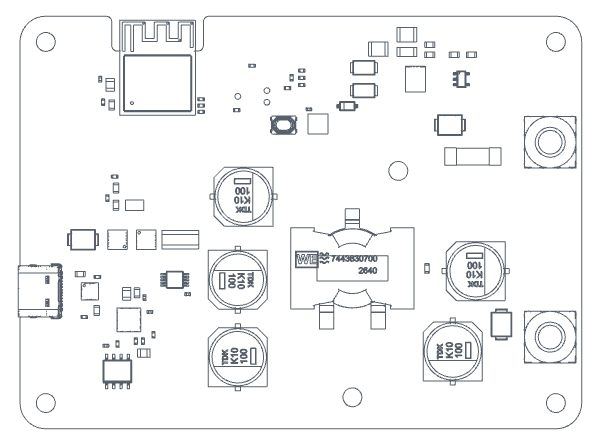
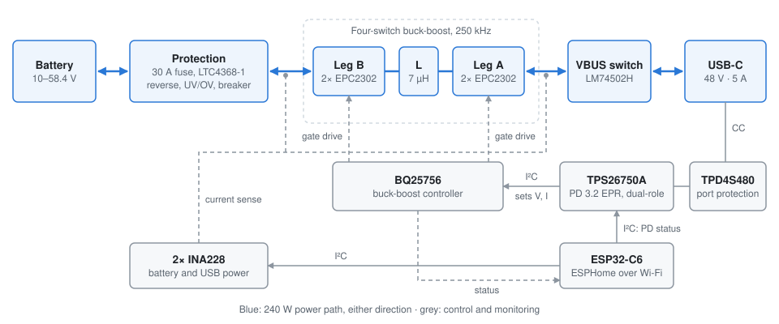
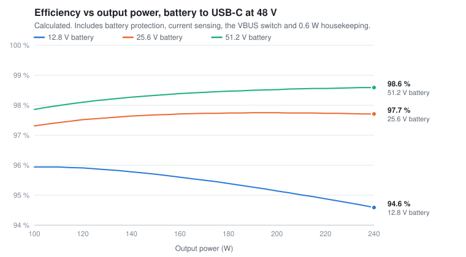
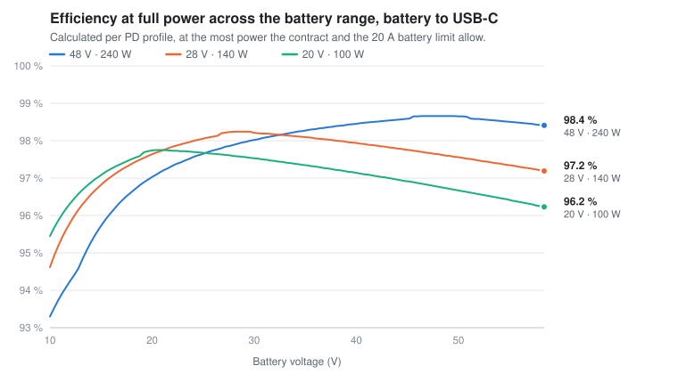
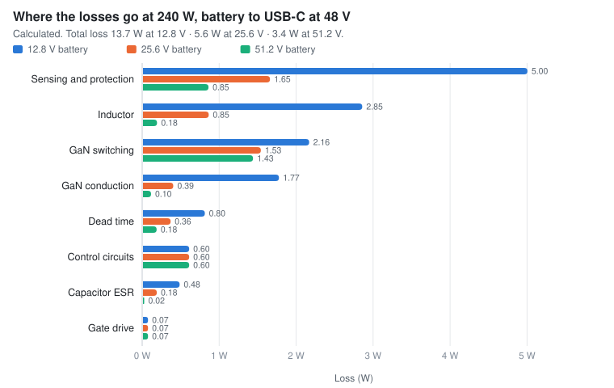
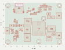
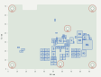

# USB-PD 240 W Bidirectional Converter

**240 W USB-C Power Delivery in both directions, for 12 V to 48 V lithium batteries**

<picture>
  <source media="(prefers-color-scheme: dark)" srcset="docs/img/board-routed-dark.gif">
  
</picture>

> **Status: in design.** The schematic is captured and the 6-layer PCB is placed and fully routed,
> with a clean design-rule check; a design review comes before the first boards are ordered. The
> drawing above is the current 3D model, top side then bottom. Not yet built or tested — every
> efficiency figure here is calculated, not measured.

A single board between a **10–58 V battery or DC bus** and a **USB-C port** that moves up to
**240 W either way**. It sources every USB PD voltage from 5 V to 48 V (SPR, EPR and AVS) to
laptops, phones and tools, and it charges the battery from any USB PD charger with a proper CC/CV
profile. A TI BQ25756 four-switch buck-boost controller drives four 100 V GaN FETs directly, so the
same hardware regulates whether the battery sits above or below the USB voltage. One board serves
12 V, 24 V and 48 V systems; the chemistry and cell count are a build variant.

- **Bidirectional:** battery → USB-C (source) and USB-C → battery (charge), chosen automatically by the PD role
- **USB PD 3.2 EPR dual-role port:** 5–20 V SPR, 28 / 36 / 48 V EPR and 15–48 V AVS, up to 48 V × 5 A
- **GaN power stage:** four EPC2302 FETs on the BQ25756's 5 V gate drivers; 94.6–98.6 % calculated at 240 W
- **Protected battery input:** reverse polarity to −40 V, under/over-voltage lockout, bidirectional circuit breaker, fuse and surge clamp
- **ESPHome monitoring:** battery and USB voltage, current, power and energy, the negotiated PD contract, and temperatures over Wi-Fi

## Block diagram

<picture>
  <source media="(prefers-color-scheme: dark)" srcset="docs/img/block-diagram-dark.svg">
  
</picture>

The PD controller negotiates the contract and programs the buck-boost controller over its own I²C
bus, so power flow and charging need no firmware. The ESP32 only observes: it reads the two power
monitors and the PD controller's status on a separate bus.

## Calculated efficiency

<picture>
  <source media="(prefers-color-scheme: dark)" srcset="docs/img/efficiency-vs-load-dark.svg">
  
</picture>

<picture>
  <source media="(prefers-color-scheme: dark)" srcset="docs/img/efficiency-vs-battery-dark.svg">
  
</picture>

| Battery → USB-C at 48 V | 100 W | 240 W |
| --- | --- | --- |
| 12.8 V (4S LiFePO4) | 95.9 % | 94.6 % |
| 25.6 V (8S LiFePO4) | 97.3 % | 97.7 % |
| 51.2 V (16S LiFePO4) | 97.9 % | 98.6 % |

From a loss model of the power stage at 250 kHz and 40 °C ambient: conduction, switching,
output-capacitance, dead-time, gate-drive and inductor losses, plus the protection FETs, sense
resistors, VBUS switch and 0.6 W for the control circuits. Charging from a 48 V charger tracks
source mode to within 0.6 %. Below 12.7 V the 20 A battery-current limit caps the output (184 W
at 10 V). Light load is not shown: the model does not cover the controller's light-load mode.

<picture>
  <source media="(prefers-color-scheme: dark)" srcset="docs/img/losses-240w-dark.svg">
  
</picture>

At 240 W the loss budget moves with battery voltage. From a 12.8 V battery the converter carries
almost 20 A, so current-driven losses dominate: the sense resistors, circuit-breaker shunt and
protection MOSFETs ("sensing and protection", which also includes the VBUS switch) and the inductor's
winding resistance. From a 51.2 V battery the current is a quarter of that, and GaN switching
becomes the largest share of a 3.4 W total.

## Specifications

| Battery / DC input | |
| --- | --- |
| Voltage | 10–58.4 V: 12 V, 24 V and 48 V systems (4S–16S LiFePO4, up to 14S NMC) |
| Current | 20 A maximum, either direction |
| Terminals | 2 × Würth REDCUBE M5 |
| Build variants | 12 V 4S LiFePO4 · 24 V 8S LiFePO4 · 48 V 13S NMC · 48 V 16S LiFePO4 (charge-voltage divider only) |

| Conversion | |
| --- | --- |
| Topology | Non-inverting four-switch buck-boost: buck, buck-boost and boost regions |
| Controller | TI BQ25756, bidirectional, with an integrated CC/CV charger and 16-bit ADC |
| Switches | 4 × EPC EPC2302, 100 V, 1.8 mΩ GaN, driven directly at 5 V |
| Inductor | Würth WE-HCF 7 µH |
| Switching frequency | 250 kHz |
| Output power | 240 W from a 12.7 V or higher battery; 184 W at 10 V |
| Charge power | Up to 233 W from a 48 V / 5 A charger |

| USB-C port | |
| --- | --- |
| PD controller | TI TPS26750A, USB PD 3.2 with EPR, dual-role |
| Source profiles | 5 V 3 A · 9, 15, 20 V up to 5 A · 28, 36, 48 V 5 A (EPR) · 15–48 V AVS. Above 3 A needs a 5 A e-marked cable |
| Sink | Charges from any PD or Type-C charger up to 48 V / 5 A |
| Connector | GCT USB4105-GF-A, rated 48 V / 5 A |
| Port protection | TPD4S480: CC and SBU short-to-48 V protection and ESD |

| Protection | |
| --- | --- |
| Reverse polarity | Blocked to −40 V (LTC4368-1, back-to-back MOSFETs) |
| Under/over-voltage lockout | Disconnects below ≈ 9.2 V and above ≈ 58.2 V |
| Over-current | Bidirectional electronic circuit breaker with auto-retry; 30 A fuse rated 125 VDC as a last resort |
| Surges | TVS clamps on the battery and VBUS |
| VBUS | Isolation switch, opened on over-voltage or when no contract is active |
| Thermal | NTCs on the power stage, the inductor and the battery FETs; battery NTC input to the charger |

| Monitoring and control | |
| --- | --- |
| Microcontroller | Espressif ESP32-C6-MINI-1, running [ESPHome](esphome/usb-pd-240w.yaml) |
| Measurements | 2 × TI INA228: battery and USB voltage, current, power, energy and charge |
| PD status | Power role, active contract and the connected device's capabilities, from the PD controller |
| Programming | USB over the same USB-C port, OTA over Wi-Fi, or serial through a TC2030 header (TX, RX, EN and BOOT) |
| Indicators | Addressable RGB status LED and a BOOT / user button |
| Auxiliary power | Diode-OR from the battery and VBUS, so the board still reports faults with the battery disconnected |

| PCB | |
| --- | --- |
| Size | 98 × 72 mm |
| Stackup | 6 layers, 2 oz outer and 1 oz inner copper |
| Thermal | GaN half-bridges and battery FETs on the bottom, cooled through a gap pad into a heatsink or the enclosure floor |
| Layout | Vertical GaN power loops over an adjacent ground plane, per EPC's recommended layout; copper pours for the 20 A paths, with via stitching between layers |

## PCB placement

The placement of the routed board, with courtyard outlines and designators (mm). Tall parts —
the inductor, bulk capacitors, connectors and ESP32 — go on the top. The GaN half-bridges, their
capacitor banks, the controller and the battery FETs go on the bottom, where a heatsink or the
enclosure floor cools them through a gap pad.

**Top side**

**Bottom side**, seen through the board from the top

## Design files

The schematic and PCB are complete apart from a final design review; the board has not been
built.

| File | Contents |
| --- | --- |
| `usb-pd-240w.PrjPcb` | Altium Designer project, with the four build variants |
| `00_Top.SchDoc` | Top level: the five functional sheets, the two M5 battery terminals and the mounting holes |
| `01_BatteryProtection.SchDoc` | Battery input: 30 A fuse, surge clamps, and the LTC4368-1 with back-to-back 100 V MOSFETs for reverse-polarity, under/over-voltage and bidirectional over-current protection |
| `02_PowerStage.SchDoc` | The converter: BQ25756 controller, two EPC2302 GaN half-bridges, 7 µH inductor, battery and USB current-sense resistors, bulk and hot-loop capacitors, bootstrap clamps |
| `03_USBC_PD.SchDoc` | USB-C port: receptacle, TPS26750A PD controller and its configuration EEPROM, TPD4S480 port protector, LM74502H VBUS isolation switch and surge clamp |
| `04_Monitor_MCU.SchDoc` | Monitoring: ESP32-C6 module, two INA228 power monitors, temperature sensors, the RGB status LED, the BOOT button and the TC2030 programming header |
| `05_AuxPower.SchDoc` | Housekeeping supply: diode-OR from the battery and VBUS, 5 V buck module and 3.3 V regulator |
| `USB-PD-240W-PCB.PcbDoc` | PCB, 6 layers: placed, routed and passing DRC |
| `usb-pd-240w.BomDoc` | ActiveBOM |
| `esphome/usb-pd-240w.yaml` | ESPHome configuration; Wi-Fi and API keys come from your own `secrets.yaml` |

Components come from a SQL Server database library built with
[altium-library-manager](https://github.com/devttys1/altium-library-manager). The schematics and
PCB open without it, but updating parts from the database needs a library of your own.

## License

[CC BY-NC-SA 4.0](LICENSE). Free to study, build and adapt for non-commercial use, with
attribution and under the same terms. Commercial use needs a separate licence from the author.
